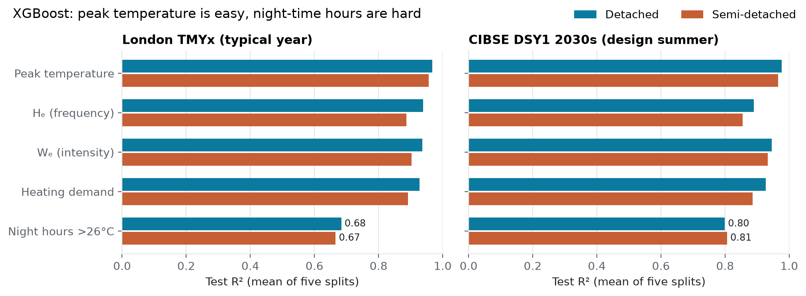
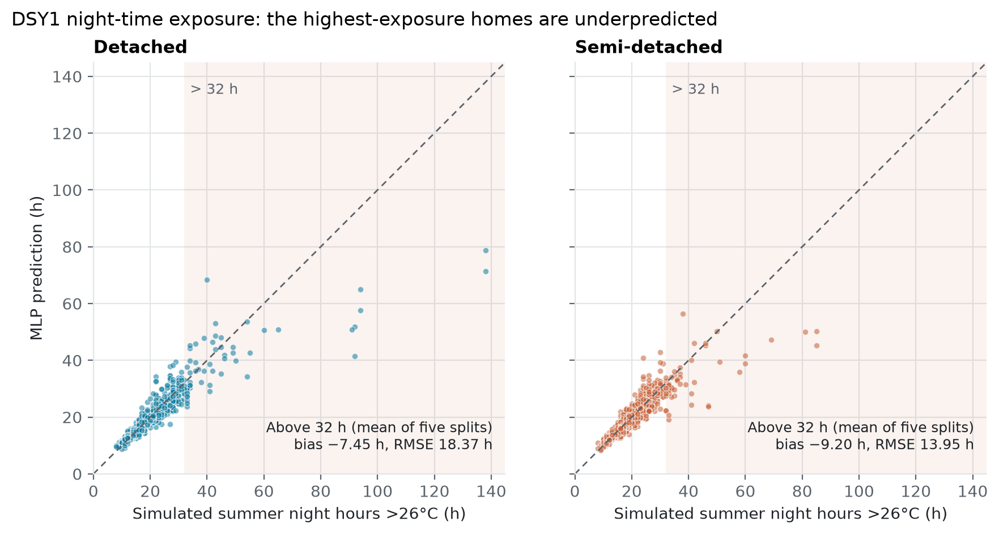
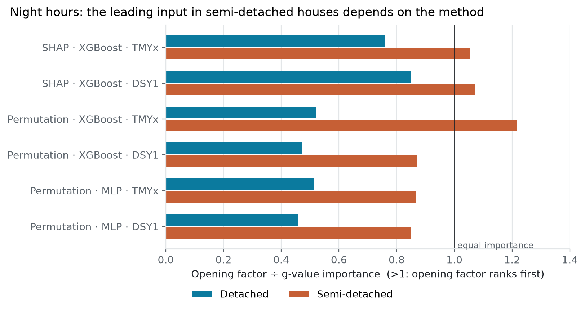

# Interpretable ML Surrogates for Overheating in UK Houses

This repository contains the code, simulation datasets, experimental results and analysis tools accompanying our BSO-uSIM 2026 paper on machine-learning surrogate models for overheating assessment in UK detached and semi-detached houses.

> Bao, H. and Gutland, M. (2026). **Interpretable Machine Learning Surrogate Models for Overheating Assessment in UK Detached and Semi-Detached Houses.** BSO-uSIM 2026, University of Strathclyde, Glasgow, 23–24 November 2026. Paper 166.

The study uses 8,000 EnergyPlus simulations across two dwelling archetypes and two weather files (London TMYx and CIBSE DSY1). Random Forest, XGBoost and multilayer perceptron models are evaluated for predicting overheating indicators and annual ideal heating demand, with particular attention to prediction errors in the high-exposure tail and the consistency of feature-importance interpretations.

## Key findings

- **Peak temperature is reliably learnable.** XGBoost test R² is 0.956–0.977 across both archetypes and both weather files; MAE is below 0.1 °C.
- **Aggregate accuracy hides tail failure.** Under the CIBSE design summer year, night-time R² *rises* (0.68 → 0.80, detached, MLP) while RMSE doubles (1.84 → 3.92 h). For homes above 32 night hours, the MLP underpredicts by 7.5 h (detached) and 9.2 h (semi-detached), with subgroup RMSE of 18.4 and 14.0 h.
- **Explanations are conditional.** For night-time exposure, glazing g-value leads in detached houses under every method; in semi-detached houses SHAP ranks window opening factor first while permutation importance mostly ranks g-value first.

<p align="center"></p>
<p align="center"></p>
<p align="center"></p>

## Study design

| Aspect | Setting |
| --- | --- |
| Archetypes | Two-storey detached house; semi-detached variant with an adiabatic party wall, fewer openings and a smaller ground perimeter |
| Design inputs | 14 continuous parameters (geometry, orientation, WWR, glazing, insulation, roof absorptance, infiltration, window opening, overhang), 2,000 Latin hypercube samples per archetype |
| Simulation | EnergyPlus 25.1; free-running summer, ideal-loads heating |
| Weather | London St James's Park TMYx 2009–2023; CIBSE DSY1 2030s High emissions 50th percentile |
| Targets | Hₑ (TM52 C1 proxy), Wₑ (TM52 C2 proxy), peak operative temperature, summer bedroom night hours >26 °C, annual heating demand |
| Models | RF, XGBoost, MLP; six candidate configurations each; five matched 70/15/15 splits; selection on validation loss only |
| Interpretation | XGBoost TreeSHAP; held-out permutation importance for XGBoost and MLP |

The targets are **screening proxies** on simplified schedules, not formal TM52/TM59 compliance results. Models are retrained for each weather file; cross-climate transfer is not tested.

## Repository layout

```
config/      parameter bounds, IDF templates, the fixed training protocol, data checksums
data/        final datasets (2 weather files x 2 archetypes x 2,000 cases), samples, splits
results/     scores, held-out predictions, night-time diagnostics, SHAP and permutation importance
figures/     the figures above, drawn from results/
src/         the full pipeline (below)
tests/       fast regression tests
```

| Module | Role |
| --- | --- |
| `src/geometry.py` | Sampled design → window layout, occupancy and IDF placeholder values |
| `src/idf.py` | Final IDF corrections applied as checked in-place field edits |
| `src/simulate.py` | Build IDFs from the samples and optionally run EnergyPlus |
| `src/metrics.py` | TM52/TM59-based targets from hourly EnergyPlus output |
| `src/models.py` | RF, XGBoost and MLP fitting and prediction |
| `src/evaluation.py` | Test scores, night-time tail diagnostics, SHAP and permutation importance |
| `src/train.py` | The full training and evaluation protocol |
| `src/report.py` | Summary tables derived from per-split results |
| `src/verify.py` | Consistency checks on the published data and results |
| `src/figures.py` | The figures in `figures/` |

Column definitions are in [DATA.md](DATA.md).

## Quick start

Python 3.12 with the recorded package versions:

```sh
python -m pip install -r requirements.txt
python -m unittest discover -s tests -v   # ~5 s
python src/verify.py                      # checks every published score against the saved predictions
python src/figures.py                     # redraws figures/
```

Retrain (each weather file takes roughly 15 minutes on one CPU core; output goes to a new folder):

```sh
python src/train.py TMYx --output output/training
python src/train.py DSY1 --output output/training --seeds 42
```

Generate simulation inputs, or simulate with your own EnergyPlus 25.1 and weather file:

```sh
python src/simulate.py detached --output output/idf_detached
python src/simulate.py semi --output output/sim_semi --energyplus /path/to/energyplus --weather /path/to/weather.epw
```

Weather files are not redistributed: TMYx is available from [Climate.OneBuilding](https://climate.onebuilding.org/), and DSY1 requires a CIBSE licence.

## Reproducibility

- `src/simulate.py` regenerates IDFs that are byte-identical to the 4,000 files that were simulated, and `src/metrics.py` reproduces every published target exactly from the hourly outputs.
- `src/verify.py` recomputes all 500 score rows from the saved predictions and the summary tables from the per-split results.
- Retraining is deterministic on a given machine (single-threaded, fixed seeds). The published results were produced on Apple Silicon; on other platforms, random subsampling in XGBoost and floating-point summation can shift some scores in the third decimal place.

## Citation

```bibtex
@inproceedings{bao2026overheating,
  author    = {Bao, Houlin and Gutland, Michael},
  title     = {Interpretable Machine Learning Surrogate Models for Overheating Assessment in {UK} Detached and Semi-Detached Houses},
  booktitle = {Proceedings of BSO-uSIM 2026},
  address   = {Glasgow, UK},
  year      = {2026}
}
```
